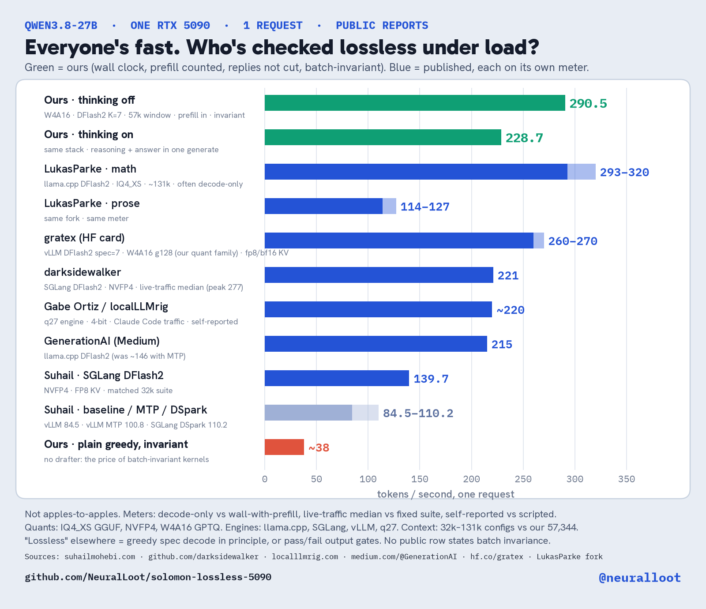

# Solomon: lossless Qwen3.8-27B on one RTX 5090

Most fast local demos cheat somewhere: different answers under load, cut replies, or a meter that skips prefill. That matters the moment a second person uses the box: if their request can change a token you already saw, you have a demo, not a product. Solomon is the opposite bet, on one consumer 5090.

**Lossless, defined:** speculative greedy output is token-for-token identical to plain greedy of the *same 4-bit checkpoint*, and a second in-flight request cannot flip a token (batch-invariant kernels). Last check 16/16 prompts, including 4-wide. Not a BF16 match (BF16 doesn't fit).

**4 Nov 2026 · window 57,344 · W4A16 + DFlash K=7 · 16-prompt bench, temp 0, replies NOT cut, wall includes prefill**

| | 1 request | 4 requests | Kept/step | Acceptance |
| --- | ---: | ---: | ---: | ---: |
| Thinking off | **290.5 tok/s** | **614.3 tok/s** | ~5.67 | 0.666 |
| Thinking on | **228.7 tok/s** | **467.4 tok/s** | ~4.74 | 0.534 |

More charts: [what lossless means here](assets/solomon-lossless.png) · [under load](assets/solomon-load.png) · script `assets/make_charts.py`. Full table: [PUBLIC_COMPARES.md](PUBLIC_COMPARES.md).

**How we differ from the public 5090 field** (LukasParke llama.cpp, gratex vLLM W4A16, darksidewalker SGLang NVFP4, Gabe Ortiz q27, GenerationAI, Suhail Mohebi; not apples-to-apples):
- **Meter:** wall clock with prefill, replies never cut. Many public numbers are decode-only, live-traffic medians, or self-reported.
- **Lossless is measured:** identity vs plain greedy checked, not assumed from the algorithm or a pass/fail quality gate.
- **Batch-invariant:** no public report we found states it.
- **The tax:** plain greedy on invariant kernels is ~38 tok/s; DFlash2 K=7 buys it back without changing a token.
- **Quant/context differ:** W4A16 GPTQ at 57,344 vs IQ4_XS ~131k, NVFP4 32k–80k, etc.

Decode-only, easy text, evening 4 Nov (still tuning, not the primary claim): **381 tok/s** (900 tok), **378 tok/s** (700 tok).

Identity history: last plain-vs-spec run 16 Oct, 16/16 incl. 4-in-flight; 4 Nov strings match 3 Nov spec strings 16/16.

**Thinking on** writes reasoning and answer in **one generate** — the answer continues in the cache the reasoning just filled. Do not stop at the closing tag and start a second request for the answer. The older stop+prefill path on the same prompts was **180.3 / 352.1** (same 4.74 keep). An earlier non-thinking boot was **253.3 / 537.8**; this boot is **290.5 / 614.3** with the same 5.67 keep.

> Deprecated: 235.1 / 510.8 (off) and 211.8 / 427.8 (on) cut every reply at 384 tokens — kernel-change history only (see HANDOFF.md).

Still pushing the envelope; these are the locked numbers so far.

## Method summary
- **Weights:** W4A16 — int4, group 128, symmetric GPTQ, Marlin, ~16.4 GB; bf16 activations. 68 layers (20 full attn, 48 Gated DeltaNet).
- **Drafter:** DFlash2, block 8, served at K=7 (verify 8 tokens/forward). 5 sliding-attn layers, ~1.2 GB W4A16. Taps target hidden states at **[5, 20, 35, 49, 64]**. Sampled requests use `draft_sample_method=probabilistic`.
- **Server highlights:** `max_model_len 57344`, `max_num_seqs 8`, `max_num_batched_tokens 8192`, `max_cudagraph_capture_size 64`, `block_size 64`, `mamba_ssm_cache_dtype float32`, fp16 KV, prefix caching on, async scheduling off, eager off, packed recurrent GDN decode off, batch-invariant on, `PYTORCH_CUDA_ALLOC_CONF=expandable_segments:True`, seed 0.
- **Kernel rules that keep greedy:** per-token GDN kernels for decode+verify; fp32 recurrent state; one batch-invariant RMSNorm; async off; Marlin calls chunked to ≤16 rows; atomic split-K only on those 16-row calls; split-KV attention with fixed 16 segments, striped by position; GDN prefill on 64-token grid; bf16 tile chosen by (N,K) never M.
- **Measured and not kept:** lookup drafting (re-tested; off fell 290.5/614.3 → 239.8/503.9), K=15, block-16 drafter, draft trees, async scheduling, atomic reduce on every row (181.6/462.2), capture through 256 (238.5/515.7), fp8 KV, FP4 GEMM at decode width, unchunked Marlin >16 rows.

## Reproduce
1. Boot with the settings above; confirm health check reports **window 57,344 and K=7** (a 32,768 fallback is a different server).
2. Warm with one short call (clock ramp).
3. Run the 16 prompts at temp 0, **no 384 cut** (only the 32,768 server hard stop). Thinking off and on as separate reads. Thinking on = one generate for reasoning+answer.
4. Run 1 request, then the same 16 four at a time. Report completion tokens ÷ wall seconds (prefill included).
5. Tokens/step = 1 + accepted/drafts from draft counters.

## Public compares (honest)
See [PUBLIC_COMPARES.md](PUBLIC_COMPARES.md): source | quant | engine | meter | batch-invariant | tok/s, with what "lossless" means for each.

Full detail: HANDOFF.md, SOURCE_4NOV.md.
